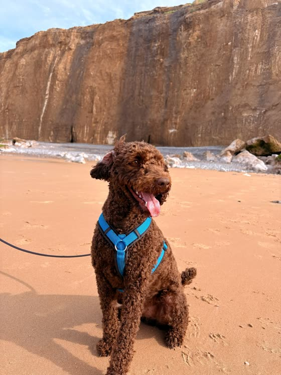

  <picture>
    <source media="(prefers-color-scheme: dark)" srcset="https://raw.githubusercontent.com/stinoooo/stinoooo/output/card-dark.svg" />
    <source media="(prefers-color-scheme: light)" srcset="https://raw.githubusercontent.com/stinoooo/stinoooo/output/card-light.svg" />
    
  </picture>

### hi, i'm stijn 👋

I'm a software engineering student from the Netherlands, and I like making things all the way
through: the code, but also the icon, the installer, the little sound when something works. Most
of what I build ends up under [Arcnode](https://arcnode.dev), my small studio for my own projects
and the occasional client.

Lately I've been learning to make games, which turned out to be the most fun I've had with a
computer in years.

### what i'm up to

- 🚓 **[Exit Only](https://arcnode.dev/projects/exit-only)**, a police chase through a rainy night
  city that changes every run, with a sliding-car puzzle on the side. Godot, Blender, and a lot of
  late-night playtesting.
- 🎮 **[Arcnode Games](https://arcnode.dev/projects/arcnode-games)**, the little launcher that
  installs and updates it.
- 🖥️ **[Arcnode Remote](https://arcnode.dev/projects/arcnode-remote)**, my own remote support app
  for Windows: help anyone over the internet with a one-time code, see every screen at once, chat,
  send files and use support tools the other person allows, all end-to-end encrypted. One day for sale.
- 📓 **[ArcJournal 2.1](https://github.com/stinoooo/ArcJournal/releases/tag/v2.1.0)**, my journaling app,
  just shipped: end-to-end encrypted, signs in with Arcnode only, and updates itself on Windows, macOS and Linux.
- ☕ **Learning Java** for school, and how AI actually works under the hood instead of only how to
  use it.

### things i'm proud of

<a href="https://arcnode.dev/projects/exit-only"><picture><source media="(prefers-color-scheme: dark)" srcset="https://raw.githubusercontent.com/stinoooo/stinoooo/output/project-exit-only-dark.svg" /><source media="(prefers-color-scheme: light)" srcset="https://raw.githubusercontent.com/stinoooo/stinoooo/output/project-exit-only-light.svg" /></picture></a>
<a href="https://github.com/stinoooo/ArcJournal"><picture><source media="(prefers-color-scheme: dark)" srcset="https://raw.githubusercontent.com/stinoooo/stinoooo/output/project-arcjournal-dark.svg" /><source media="(prefers-color-scheme: light)" srcset="https://raw.githubusercontent.com/stinoooo/stinoooo/output/project-arcjournal-light.svg" /></picture></a>
<a href="https://arcnode.dev/projects/arcnode-games"><picture><source media="(prefers-color-scheme: dark)" srcset="https://raw.githubusercontent.com/stinoooo/stinoooo/output/project-arcnode-games-dark.svg" /><source media="(prefers-color-scheme: light)" srcset="https://raw.githubusercontent.com/stinoooo/stinoooo/output/project-arcnode-games-light.svg" /></picture></a>
<a href="https://arcnode.dev/projects/arcnode-remote"><picture><source media="(prefers-color-scheme: dark)" srcset="https://raw.githubusercontent.com/stinoooo/stinoooo/output/project-arcnode-remote-dark.svg" /><source media="(prefers-color-scheme: light)" srcset="https://raw.githubusercontent.com/stinoooo/stinoooo/output/project-arcnode-remote-light.svg" /></picture></a>
<a href="https://github.com/stinoooo/ArcFlux"><picture><source media="(prefers-color-scheme: dark)" srcset="https://raw.githubusercontent.com/stinoooo/stinoooo/output/project-arcflux-dark.svg" /><source media="(prefers-color-scheme: light)" srcset="https://raw.githubusercontent.com/stinoooo/stinoooo/output/project-arcflux-light.svg" /></picture></a>
<a href="https://arcnode.dev/projects/rosa-wildlife-reserve"><picture><source media="(prefers-color-scheme: dark)" srcset="https://raw.githubusercontent.com/stinoooo/stinoooo/output/project-rosa-dark.svg" /><source media="(prefers-color-scheme: light)" srcset="https://raw.githubusercontent.com/stinoooo/stinoooo/output/project-rosa-light.svg" /></picture></a>
<a href="https://arcnode.dev/projects/vardoxen"><picture><source media="(prefers-color-scheme: dark)" srcset="https://raw.githubusercontent.com/stinoooo/stinoooo/output/project-vardoxen-dark.svg" /><source media="(prefers-color-scheme: light)" srcset="https://raw.githubusercontent.com/stinoooo/stinoooo/output/project-vardoxen-light.svg" /></picture></a>
<a href="https://arcnode.dev"><picture><source media="(prefers-color-scheme: dark)" srcset="https://raw.githubusercontent.com/stinoooo/stinoooo/output/project-arcnode-dark.svg" /><source media="(prefers-color-scheme: light)" srcset="https://raw.githubusercontent.com/stinoooo/stinoooo/output/project-arcnode-light.svg" /></picture></a>

### and a few smaller ones

| | |
| --- | --- |
| [ArcUnzip](https://github.com/stinoooo/ArcUnzip) | Open a .zip right in the browser. [Try it](https://unzip.arcnode.dev). |
| [rosa-vscode](https://github.com/stinoooo/rosa-vscode) | A VS Code theme with Rosa Wildlife Reserve colors, icons and a pixel dinosaur. |
| [AutoMod badge bot](https://github.com/stinoooo/discord-automod-bot-badge) | Sets up AutoMod rules so a Discord bot earns its AutoMod badge. |

### my favorite co-worker

This is **Banjer**, head of quality assurance. Most of my bugs get solved on his walks. He is
very good at the beach, less good at code review, and always happy to see me when a build
finally passes.

 

### my year on github

  <picture>
    <source media="(prefers-color-scheme: dark)" srcset="https://raw.githubusercontent.com/stinoooo/stinoooo/output/heatmap-dark.svg" />
    <source media="(prefers-color-scheme: light)" srcset="https://raw.githubusercontent.com/stinoooo/stinoooo/output/heatmap-light.svg" />
    
  </picture>

### say hi

Always happy to talk about games, side projects or anything you're building.
Find me on Discord as **bossmannn**, on [X as @s_tinoo](https://x.com/s_tinoo), or through
[arcnode.dev](https://arcnode.dev).

The cards above are drawn by a small script in this repository and redrawn every morning.
